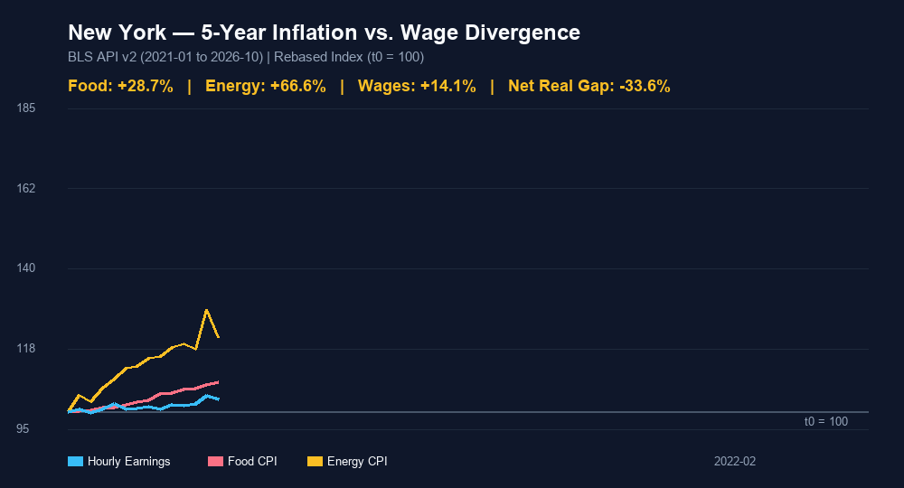
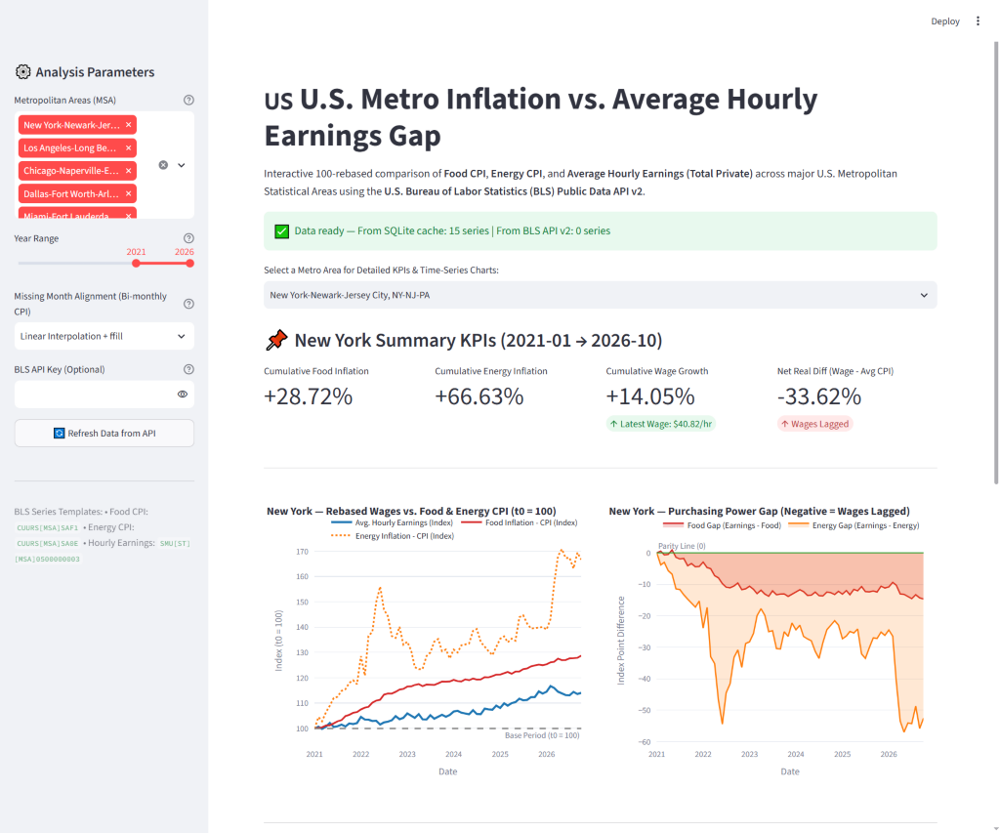
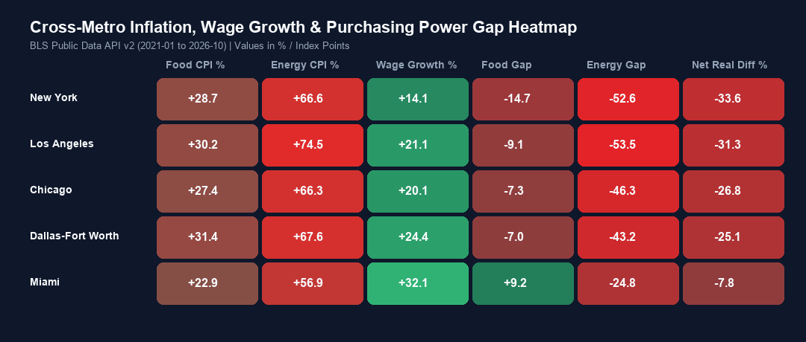

<p align="center">
  
</p>

<h1 align="center">U.S. Metro Inflation vs. Average Hourly Earnings Gap (BLS API v2)</h1>

<p align="center">
  
  
  
  
  
</p>

An end-to-end, modular Python data engineering and interactive analytics application answering the research question:

> **"How has the gap between Food & Energy inflation (CPI) and Average Hourly Earnings evolved over the trailing 5 years across major U.S. Metropolitan Statistical Areas (MSAs)?"**

---

## Live Demo Animation

<p align="center">
  
</p>

## Dashboard Previews

### 1. Executive KPIs, Rebased Trends (`t0 = 100`) & Purchasing Power Gap
<p align="center">
  
</p>

### 2. Cross-Metropolitan Comparison Heatmap
<p align="center">
  
</p>

---

## Architecture & Module Structure

```text
bls_msa_analysis/
├── assets/
│   ├── banner.jpg              # Project hero banner
│   ├── gap_animation.gif       # Animated 5-year divergence across all 5 MSAs
│   ├── dashboard_overview.png  # Live Streamlit KPI & Plotly charts screenshot
│   └── cross_msa_heatmap.png   # Cross-MSA comparison heatmap screenshot
├── config.py                   # BLS API v2 URL, MSA metadata, series templates & rate limits
├── data_fetcher.py             # BLS API v2 POST client, chunking/retry, SQLite cache & fallback
├── data_processor.py           # Monthly alignment (bi-monthly CPI), t0=100 rebasing & gap math
├── app.py                      # Interactive Streamlit dashboard & Plotly visualizations
├── requirements.txt            # Python dependencies
├── .gitignore
└── README.md
```

---

## Covered Metropolitan Areas & BLS Series

For each MSA, three official series are fetched from the **U.S. Bureau of Labor Statistics (BLS) Public Data API v2**:
- **Food Inflation (CPI-U Food):** `CUURS[MSA_CPI_CODE]SAF1`
- **Energy Inflation (CPI-U Energy):** `CUURS[MSA_CPI_CODE]SA0E`
- **Average Hourly Earnings (Total Private, SAE):** `SMU[STATE_FIPS][MSA_SAE_CODE]0500000003`

| Metropolitan Statistical Area (MSA) | CPI Area Code | State FIPS | SAE MSA Code | CPI Cadence |
| :--- | :---: | :---: | :---: | :---: |
| **New York-Newark-Jersey City, NY-NJ-PA** | `12A` | `36` | `35620` | Monthly |
| **Los Angeles-Long Beach-Anaheim, CA** | `49A` | `06` | `31080` | Monthly |
| **Chicago-Naperville-Elgin, IL-IN-WI** | `23A` | `17` | `16980` | Monthly |
| **Dallas-Fort Worth-Arlington, TX** | `37A` | `48` | `19100` | Bi-monthly |
| **Miami-Fort Lauderdale-West Palm Beach, FL** | `35B` | `12` | `33100` | Bi-monthly |

---

## Key Engineering Highlights

1. **Rate-Limit Aware BLS API v2 Client (`data_fetcher.py`):**
   - Automatically chunks series IDs and year ranges according to registered (`50 series / 20 yrs / 500 reqs/day`) vs. unregistered (`25 series / 10 yrs / 25 reqs/day`) limits.
   - Exponential backoff on HTTP `429` / transient failures, backed by a 24-hour **SQLite (`bls_cache.db`)** cache and deterministic synthetic fallback if offline.
2. **Time-Series Alignment & Rebasing (`data_processor.py`):**
   - Aligns bi-monthly CPI series (Dallas, Miami) onto a uniform monthly grid using linear interpolation + `ffill`/`bfill`.
   - Rebases all series to `t0 = 100` (`Index_t = (Value_t / Value_t0) * 100`) and computes **Food Gap**, **Energy Gap**, and **Net Real Diff**.
3. **Interactive Dashboard (`app.py`):**
   - Built with **Streamlit** and **Plotly** (multi-line trend chart, zero-baseline area gap chart, cross-metro table & heatmap, and raw/processed CSV export).

---

## Quick Start

```bash
git clone https://github.com/EthYusuf/bls-msa-inflation-wage-gap.git
cd bls-msa-inflation-wage-gap
pip install -r requirements.txt
```

### Optional: Set `BLS_API_KEY`
The app works out of the box without an API key (within BLS v2 unregistered limits). To use a free registered key from [BLS Registration](https://data.bls.gov/registrationEngine/):

```powershell
# Windows PowerShell
$env:BLS_API_KEY="YOUR_BLS_API_KEY"
```

```bash
# macOS / Linux
export BLS_API_KEY="YOUR_BLS_API_KEY"
```

### Run the Dashboard

```bash
python -m streamlit run app.py
```
